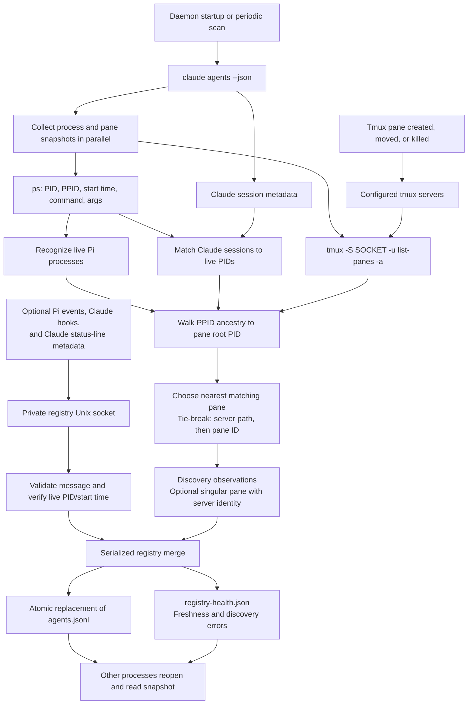

# Registry

[Documentation index](README.md) · [Agent hub](../README.md)

Unless noted otherwise, run commands from `agent-hub/registry/`; source paths
are relative to that directory. Commands labeled repository root run from the checkout root.

Machine-local registry for live Pi and Claude agents. A Node.js daemon joins
discovery observations and publisher updates, then writes **one current agent
snapshot per line** to `agents.jsonl`.

This is a current-state snapshot, not an append-only event log. It has no Pi SDK
dependency and does not require an open Pi session. The registry runs inside the
[agent-hub service](../service/README.md); there is no separate registry command.
The optional Pi publisher below is part of the `agent-hub/pi` package, and the Pi
`/agents` browser reads its snapshots and health. Claude hooks and status-line
model publishing are opt-in through `agent-hub claude install`; neither is
enabled automatically.

## Build and run

Requires Node.js 22.18+ and npm on macOS or Linux. Discovery uses `ps`; Claude
and tmux discovery additionally require their respective executables on `PATH`.
See [setup](setup.md) to install the `agent-hub` command.

```bash
cd agent-hub
npm ci
npm test --workspace @agent-hub/registry
```

```bash
agent-hub start --background                 # registry and spawn supervisor
agent-hub start --background --registry-only # registry without spawning
agent-hub status
agent-hub stop
```

- `--interval` sets discovery frequency in milliseconds; default `5000`.
- `--activity-ttl` sets activity report expiry in milliseconds; default `20000`.
  Expiry is reflected on the next snapshot write, so it can lag by a scan interval.
- The hub watches its own tmux server. Repeat `--tmux-socket` to watch more;
  paths must be absolute.
- Unix socket paths must be at most 100 bytes; use a shorter `AGENT_HUB_DIR` if
  your home or state directory would exceed that limit.

**OS-managed services and autostart are not supported**: start the hub from the
shell environment whose tmux servers and `PATH` it should use. To change its
configuration, stop it and start it again. Background output goes to the hub's
`daemon.log`; log rotation is not provided.

## Runtime files

```text
~/.local/state/agent-hub/registry/
├── registry.sock            publisher and control transport
├── writer.lock/             exclusive writer lease (directory)
├── agents.jsonl             current normalized agent snapshots
├── registry-health.json     writer freshness and discovery errors
└── daemon.log               background stdout/stderr
```

The runtime directory is owned by the current user and restricted to `0700`;
the socket and snapshot files use `0600`. A 30-second writer lease is refreshed
every 10 seconds. After a hard crash, wait for lease expiry before restarting.
Do not manually delete a live writer's lock. A compromised lease terminates the
writer rather than allowing it to continue publishing without ownership.

The new writer verifies that a leftover socket is unreachable before removing
it. It refuses to remove non-socket paths or reachable sockets.

## Architecture

```text
claude agents --json ─┐
ps process snapshot ─┼─ discovery ────┐
configured tmux ─────┘                │
                                     ▼
Optional Pi / Claude publishers ───── Unix socket ── registry store
                                                 │
                                          atomic replacement
                                                 │
                                            agents.jsonl
                                                 │
                                         read-only consumers
```

Discovery runs on startup and periodically, with at most one scan in flight.
State changes and snapshot writes are serialized. Publishers may submit updates
while a scan is collecting observations; an older scan cannot overwrite newer
published state or resurrect a replaced PID lifetime.

### Tmux discovery and event flow

Tmux does not send lifecycle or model events to the daemon. Pane creation,
movement, and termination are detected by the next discovery scan. Pi/Claude
publishing is a separate, optional input through the publishers below. Claude
CLI discovery works without hooks or status-line publication.



Each tmux server is queried separately. A successful scan clears a vanished pane
mapping; a failed server query preserves its last mapping unless another
successful mapping is found. A successful process snapshot removes an agent
whose PID exited or was reused, even if pane discovery failed. Consumers must
still revalidate identity and pane ancestry before taking an action.

### Identity and liveness

An agent's key is **harness + PID + process start time**. Session IDs are metadata,
not unique process identities. All timestamps in snapshots, publisher messages,
and health records are **Unix epoch milliseconds as non-negative safe integers**.

Process `startedAt` is collected with `TZ=UTC LC_ALL=C ps` and converted to epoch
milliseconds before identity checks or serialization. This makes identity stable
across the caller's timezone and daylight-saving changes. Its source has
**second-level precision**, so the millisecond value ends in `000`; this is not a
globally unique process identifier. `observedAt`, `reportedAt`, and daemon health
timestamps use millisecond-resolution clock readings.

Publishers can obtain numeric process identities through the exported
`listProcesses()` helper in `src/discovery/processes.ts`. Date strings are not
accepted as `process.startedAt`.

- Pi processes are recognized by their command or known Node/Bun entrypoint.
- Claude sessions come from `claude agents --json` and must have a live PID in
  the subsequent process snapshot.
- The daemon does not read the extension's legacy Pi/model registry files.
- Without publishers, Pi activity is `unknown`, and Pi session/model metadata
  is unavailable. Claude's CLI supplies its status and session metadata, but
  not the model used by this integration.
- A successful process snapshot removes exited/reused process lifetimes.
- Failed process discovery retains existing rows and reports degraded health.
  Claude CLI or tmux failures are likewise not authoritative empty results.
- Previously saved rows are **not loaded as live state on restart**. Discovery
  rebuilds the snapshot; publishers must report metadata again.

`observedAt` records the latest process verification. Discovery uses the scan's
start time conservatively, so collection latency does not make observations
appear newer than concurrent hook events. A publication performs a fresh process
check and advances `observedAt` without pretending its metadata was just reported.

### Merge semantics

- Session fields have independent timestamps. Omitting a field leaves it alone;
  `null` explicitly clears an optional session field.
- Activity is replaced as a group. Omitted `waitingFor`/`rawState` in a new
  activity report clears those fields rather than retaining an old waiting reason.
- Model is replaced as a group; `model: null` clears it.
- Newer report timestamps win. At equal timestamps, publishers beat discovery;
  equal-priority duplicate observations retain the first accepted value.
- Clear operations retain internal timestamp tombstones so delayed events cannot
  restore a cleared value.
- Activity older than its TTL is exposed as `unknown`, without a waiting reason.
  Its source, report time, and last raw state remain available. Model/session
  metadata does not have an age-only expiry.
- Pane mapping comes only from discovery. It selects the nearest process ancestry
  match; ties use server path, then pane ID. The optional singular `pane.server`
  identifies the tmux server. Successful discovery clears vanished mappings;
  failed discovery of the mapped server retains its last mapping unless a new
  successful mapping is found.

## Pi publisher

[`../pi/extensions/registry-publisher/index.ts`](../pi/extensions/registry-publisher/index.ts)
is a Pi extension that publishes to this daemon. It ships in the `agent-hub/pi` package
(install with `pi install <path-to>/agent-hub/pi`). To load only this publisher, from
the repository root:

```bash
pi --extension ./agent-hub/pi/extensions/registry-publisher/index.ts
```

Start the hub separately with `agent-hub start`. Both processes must use the
same state directory (`AGENT_HUB_DIR`, then `XDG_STATE_HOME`, then
`~/.local/state/agent-hub`). No daemon build or runtime dependencies are
needed by the publisher itself; its runtime imports are Node built-ins only.

The publisher obtains its own PID/start time from `TZ=UTC LC_ALL=C ps`, then
reports session ID/file/name/cwd, mode, selected model, and activity. TUI mode is
`interactive`; JSON, print, and RPC modes are `non-interactive`. Blocking Pi UI
prompts report `waiting` with `waitingFor: "ui_prompt"`; prompt titles and contents
are never sent. Busy runs remain busy through `agent_end`, becoming idle at
`agent_settled`. Missing session names/files and models are explicitly cleared.

Full reports are refreshed every five seconds, keeping activity fresh under the
default 20-second TTL and repopulating metadata after daemon restarts. If you
lower the daemon's activity TTL, keep it comfortably above five seconds. Identity
lookup failures skip publication and retry on the next heartbeat rather than
guessing a process lifetime. Socket requests time out after one second, with at
most one in flight and one coalesced pending update. Missing sockets, rejected
reports, and connection failures never block Pi events or print to its output.
Reload/shutdown stops timers and closes the current socket; discovery handles
process removal, rather than a publisher deleting a row on session changes.

This adds no tools, commands, agent browser, task delegation, Claude hooks, legacy
registry-file writes, or daemon management. `agent-hub/viewer/`
consumes the snapshots independently, directly or through the Pi launcher.

## Optional Claude main hook publisher

**Disabled by default.** Claude discovery uses `claude agents --json` and `ps`
without this hook. Building or starting the registry, does not install or enable it. No hook configuration is required for normal use.

Enable it only if you want event-driven updates between discovery scans (five
seconds apart by default) or the transcript path. Most published fields overlap
with CLI discovery. Hook activity is inferred, and a newer CLI observation can
replace it; the hook is not an authoritative or permanently preferred source.

[`publishers/claude/hook.mjs`](../registry/publishers/claude/hook.mjs) receives Claude Code
command-hook JSON on stdin and publishes activity/session metadata with source
`claude-hook`. **It does not publish model metadata or touch the status line.**

To explicitly enable it, run:

```bash
agent-hub claude install --hooks
# Use a different settings file (also supports project settings):
agent-hub claude install --hooks --settings /absolute/path/to/settings.json
# Remove just this integration:
agent-hub claude uninstall --hooks
```

The default settings file is `$CLAUDE_CONFIG_DIR/settings.json`, otherwise
`~/.claude/settings.json`. Installation is idempotent, creates missing settings,
and adds handlers without replacing existing hooks or unrelated settings.
`statusLine` is left unchanged. The installer records recovery information and
the original settings in `<settings>.agents-registry-hooks.json` with mode `0600`.
Uninstall removes only handlers with the installed command, preserving later
settings and other hooks; it does not restore the whole saved settings file.
Settings symlinks are refused: pass their source file explicitly. Installation
does not start the daemon. Restart Claude Code or
review `/hooks` to ensure the new hook configuration is loaded.

The installer uses the current Node executable and an absolute path to the hook;
keep both paths available. The hook imports the registry's `src/` client and process
parser. A moved or broken installation silently skips publication. Claude must
inherit the same state directory configuration as the daemon:
`AGENT_HUB_DIR`, then `XDG_STATE_HOME`, then `~/.local/state/agent-hub`.

| Hook event | Activity |
| --- | --- |
| `SessionStart`, `Stop` | `idle` |
| `UserPromptSubmit`, `PreToolUse`, `PostToolUse`, `PostToolUseFailure` | `busy` |
| `PreToolUse` for `AskUserQuestion` | `waiting`, reason `user_input` |
| `PermissionRequest`, `Notification` of type `permission_prompt` | `waiting`, reason `permission` |
| `Notification` of type `idle_prompt` | `waiting`, reason `idle_prompt` |
| `SessionEnd` | `unknown`; discovery handles process removal |

Other events/notifications and inputs identifying a subagent (`agent_id`) are
ignored. `SubagentStop` does not mark the main Claude process idle. Session fields
are ID, transcript path, and cwd when valid; omitted fields are left alone. No
prompt text, tool arguments/results, notification messages, or model data are
forwarded. The event name is retained as `activity.rawState`.

Identity is the nearest verified Claude ancestor in a `TZ=UTC LC_ALL=C ps`
snapshot, including an intervening shell. Native `claude` processes and Node
running the standard npm `@anthropic-ai/claude-code/cli.js` entrypoint are
recognized. Missing/unrecognized ancestry skips publication; session IDs are
never used to guess a PID. The daemon separately verifies the PID/start time.

Hooks run synchronously to avoid detached-hook reparenting and delayed event
reordering, but are best-effort: process observation times out after one second
and the socket request after 500 ms. They always exit successfully and print no
output, including when the registry is absent or rejects an update. stdin has
an 8 MiB limit; over-limit inputs are skipped rather than partially published.

**Activity is an observation, not an authoritative turn state.** Another Stop
hook can prevent completion after this hook reports idle. There is no heartbeat:
a long turn or permission wait can exceed the default 20-second activity TTL,
after which activity can become `unknown` unless refreshed by discovery or a
new hook event. After a daemon restart, session metadata is republished on the
next hook invocation. The hook adds no persistent worker or status-line publisher.

## Optional Claude status-line model publisher

**Disabled by default and independent of the hook publisher.** This integration
wraps an existing command status line; it does not replace your renderer or
install a default one. Build the workspace, then explicitly opt in:

```bash
agent-hub claude install --statusline
agent-hub claude install --statusline --settings /absolute/path/to/settings.json
agent-hub claude uninstall --statusline
```

The settings path defaults to `$CLAUDE_CONFIG_DIR/settings.json`, otherwise
`~/.claude/settings.json`. An existing non-empty `statusLine.command` with
`type: "command"` is required. Installation changes only that command, preserving
padding, refresh settings, hooks, and unrelated configuration. It uses the current
Node executable and an absolute wrapper path; keep both paths available.
Installation is idempotent and is not part of daemon startup.
Restart Claude Code to ensure it loads the new command.

Recovery information is stored in `<settings>.agents-registry-statusline.json`
with mode `0600`. Uninstall restores only the original renderer command and
preserves later settings. If the command has been replaced with another renderer,
install/uninstall refuses to overwrite it. Settings and backup symlinks are refused;
use the settings source file explicitly. A retained backup lets a repeated install
or uninstall complete an interrupted settings write.

[`publishers/claude/statusline-wrapper.mjs`](../registry/publishers/claude/statusline-wrapper.mjs)
streams the original stdin bytes to the renderer and preserves its stdout, stderr,
exit status, and cancellation signals (forwarded to the renderer process group).
Rendering starts immediately, independently of process observation and socket
latency. A bounded copy of stdin is used for metadata; inputs over 8 MiB are still
forwarded in full but are not published.

Each invocation publishes valid session ID, transcript path, cwd, and
`model.id`/`model.display_name` (normalized to `displayName`) with source
`claude-statusline`. No model provider is inferred. Missing/invalid fields are
omitted; an explicit `model: null` clears the model. Context-window fill is
published as `context: { tokens, window }` from `context_window`: tokens are the
`current_usage` input + cache-creation + cache-read counts, falling back to
`used_percentage` × `context_window_size`, or `null` when neither is present.
Activity, cumulative usage/cost, prompts, and messaging endpoints are never
published.

Snapshots carry `context: { tokens, window, source, reportedAt }` only from the
Pi publisher (`ctx.getContextUsage()`) and this status line; `tokens: null` means
the window is known but current usage is not (e.g. right after compaction).

Like the hook, it identifies the nearest native/npm Claude ancestor through
`TZ=UTC LC_ALL=C ps`, never the wrapper PID or a session-ID lookup. Missing
identity, malformed/subagent inputs, unavailable builds, and socket failures
silently skip publication without affecting rendering. Process observation times
out after one second and socket requests after 500 ms. The wrapper remains alive
until rendering and the bounded publication attempt finish; telemetry can delay
final command completion, but not renderer output. Cancellation stops the wrapper
without waiting for telemetry.

The wrapper imports the registry's `src/` client and process parser. Claude must
inherit the same state-directory environment as the daemon (`AGENT_HUB_DIR`,
then `XDG_STATE_HOME`, then `~/.local/state/agent-hub`). There is no heartbeat:
model/session metadata is republished on the next Claude status-line invocation,
including after daemon restarts. This is a socket publisher, not the legacy
per-session-file wrapper under `pi/extensions/agents/`.

## Publisher interface

Canonical schemas:

- [`schemas/agent-snapshot.schema.json`](../registry/schemas/agent-snapshot.schema.json):
  one reader-facing snapshot, with optional singular `pane`.
- [`schemas/publisher-message.schema.json`](../registry/schemas/publisher-message.schema.json):
  publishing and control messages.

The socket accepts **one newline-terminated JSON request per connection** and
returns one newline-terminated response before closing:

```json
{"ok":true}
```

Rejected messages return `{"ok":false,"error":"..."}`. Request bodies are limited
to 64 KiB. Connections have a 10-second inactivity timeout; clients should also
use an overall timeout. Connections and queued operations are bounded.

Example publication shape (replace the identity and timestamp with actual values):

```json
{
  "version": 1,
  "type": "publish",
  "harness": "pi",
  "process": {
    "pid": 12345,
    "startedAt": 1791367200000
  },
  "source": "pi",
  "reportedAt": 1791367205000,
  "patch": {
    "session": {
      "id": "session-id",
      "cwd": "/repo",
      "mode": "interactive"
    },
    "activity": {
      "state": "busy",
      "rawState": "working"
    },
    "model": {
      "provider": "anthropic",
      "id": "model-id"
    }
  }
}
```

The top-level `harness` identifies the agent harness (`pi` or `claude`);
`model.provider` identifies the model provider (for example, `anthropic`).
The former top-level `provider` field is no longer accepted. Update publishers
and readers, then rebuild and restart an existing writer to regenerate snapshots.
Schema and message versions remain `1`.

Sources are `pi`, `claude-hook`, and `claude-statusline`. Pi must use source `pi`;
Claude must use a Claude source. The status-line source cannot publish activity.
The message requires a verified PID/start-time identity; **session-only updates
are not supported in version 1**. Publishers must identify their agent process,
not the hook/status-line subprocess. Missing/ambiguous identity should cause a
publisher to skip its update, not guess a PID.

The daemon verifies process identity before accepting a publication. It rejects
report timestamps more than five seconds in the future or before the numeric
process start time. Model identifiers should be separated from their optional
provider rather than joined into `provider/model-id`.

Exercise a publisher without installing integrations:

```bash
agent-hub publish < message.json
```

Other TypeScript/JavaScript publishers can use the bounded-time client:

```js
import { request } from './src/client.ts';

try {
  const response = await request(runtimeDirectory, publication, 1000);
  if (!response.ok) {
    // Handle or ignore rejection according to the caller's needs.
  }
} catch {
  // Best-effort publishers must not interrupt the agent when unavailable.
}
```

This transport trusts programs running as the same OS user. Process verification
establishes liveness, not proof that the sender owns the claimed agent. There is
no per-publisher authentication or messaging authorization. The ordinary snapshot
contains no prompts, responses, credentials, or Claude messaging socket paths.
Pi may explicitly advertise its private message-listener socket as described below.

## Optional Pi messaging endpoint

The [`message-listener` extension](message-listener.md)
opens a private Unix socket in TUI sessions. The existing Pi publisher advertises
it through optional `patch.messaging`:

```json
{"transport":"unix","path":"/absolute/path/to/in.sock","protocol":"pi-listener-v2"}
```

Only source `pi` / harness `pi` may publish this field. `messaging: null` clears
it; omission preserves it. The group has an independent report timestamp and
clear tombstone, like model metadata. The snapshot's optional `messaging` field
contains the endpoint plus `reportedAt`. Advertisements expire using the activity
TTL (20 seconds by default), reflected on the next snapshot write. The Pi
publisher refreshes them every five seconds and makes a bounded shutdown clear.

This is endpoint discovery, **not message routing**: send messages directly to
the advertised socket. The registry does not open, probe, authenticate, or send
to that endpoint. Its process verification proves liveness, not endpoint
ownership. Check registry health and process identity and handle connection
failures. Missing registry service does not prevent the listener from operating.

The schema version is `1`. Claude publishers cannot
advertise endpoints, and Claude's internal messaging paths remain undisclosed.

## Reader interface

Read `agents.jsonl` afresh and parse each non-empty line independently. An empty
file means zero currently recorded agents. Writers use same-directory temporary
files and atomic rename, so readers see a complete old or new snapshot. Readers
must reopen the path for fresh data; watching only the old inode is insufficient.

Check `registry-health.json` for `state`, `updatedAt`,
`lastSuccessfulProcessDiscoveryAt`, and `errors`. A stopped/crashed writer leaves
its last snapshot readable; that does not imply the agents remain live. Empty
snapshots also need this health check because they contain no per-row timestamp.

The snapshot and health file are individually atomic, **not a transactional pair**.
This version makes no power-loss durability guarantee. Consumers taking actions
must reverify process identity and pane ancestry immediately before acting.

## Verification

```bash
npm test
npm run typecheck
```

Tests cover normalized discovery, input validation, partial merges, stale activity,
PID reuse, delayed scan ordering, concurrent publications, degraded discovery,
private snapshot writes, socket limits, exclusive ownership, compiled CLI
background lifecycle, and hard-crash recovery. Claude publisher tests cover
ancestor identity, normalized metadata, renderer byte/exit/signal passthrough,
registry/build failures, and opt-in installer recovery and conflict handling.
CLI and publisher tests use temporary runtime/settings directories and fixture
executables; they do not modify user settings or leave the registry running.
