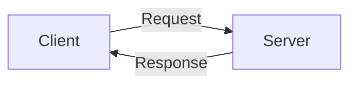

# Visual explanations in Pi

Pi supports automatic rendering of fenced Mermaid blocks in assistant messages. Present the block directly in the response; a dedicated rendering tool is not required. Rendering is controlled by `markdown.mermaid`, with modes `streaming`, `final`, and `off`.

## Example

This illustrates Mermaid syntax and an optional caption, not a required diagram style or layout:

````markdown


_Figure 1. The client sends a request; the server returns a response._
````

Choose the diagram type, labels, and surrounding prose to suit the explanation.
