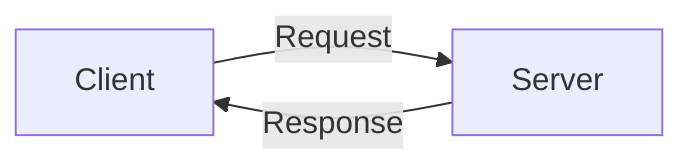

# Visual explanations in Pi

Pi supports automatic rendering of fenced Mermaid blocks in assistant messages. Present the block directly in the response; a dedicated rendering tool is not required. Rendering is controlled by `markdown.mermaid`, with modes `streaming`, `final`, and `off`.

For a diagram, use a fenced `mermaid` block like this:

````markdown


_Figure 1. The client sends a request; the server returns a response._
````

Replace the example with a diagram relevant to the explanation so the user sees the visual itself.
